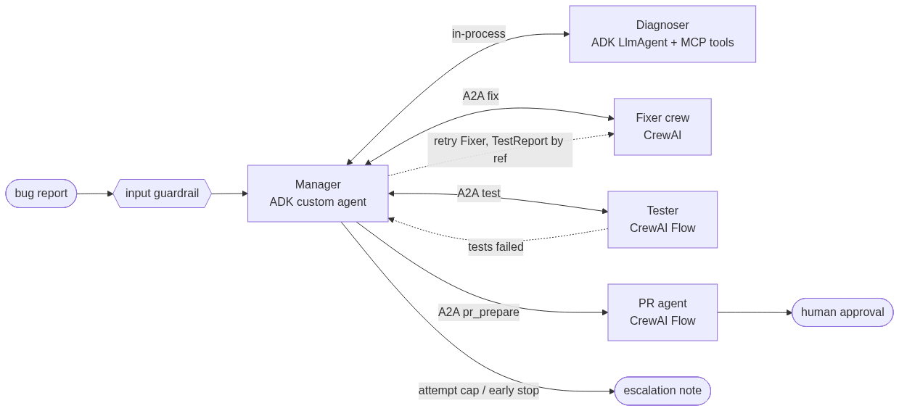

# CodeFix AI — Architecture & design rationale

> Written so sections can be lifted into the final report. Every claim below is backed by
> code (file references) or by run data (`runs.db`, `traces/*.jsonl`, `benchmarks/results/*`).

## 0. Course requirements → where they are met

| # | Requirement | Implementation |
|---|---|---|
| 1 | Context sharing via state; compare messaging architectures; **Blackboard is a must** | SQLite Blackboard of typed envelopes (`codefix/blackboard/`); three messaging architectures behind one switch, benchmarked on the same bugs (§2, §8) |
| 2 | ≥ 2 external tools via **MCP** | one MCP server, 16 tools: code search (ripgrep + vectors), file reader, stack-trace parser, linter, test runner, git, RAG (ChromaDB) (§3) |
| 3 | Structured output with **Pydantic** | Every agent output and every message is a Pydantic model; final output is JSON + unified diff + Markdown reports (§3) |
| 4 | Agentic design patterns, evaluated against others | Manager–worker (hierarchical), ReAct, Reflection (Reviewer agent), Human-in-the-loop, Guardrails; compared with sequential & peer-to-peer orchestration and with few-shot prompting (§5) |
| 5 | Monitoring & logging via **callbacks** | ADK `before/after_agent/model/tool` + `on_tool_error` callbacks, CrewAI event-bus listener + `step_callback`/`task_callback` (`codefix/observability/callbacks.py`) (§7) |
| 6 | **A2A** agent-to-agent, interoperable frameworks | ADK agents call the CrewAI agents over the A2A protocol (official `a2a-sdk`, JSON-RPC), with a public agent card (§4) |
| 7 | **Only CrewAI and ADK** | Orchestration and LLM agents in Google ADK, worker agents in CrewAI; no other agent framework is installed or imported (`tests/test_frameworks.py::test_only_crewai_and_adk_agent_frameworks`) |
| 8 | **Guardrails**; prompt variants | Input screening (prompt injection, abuse), tool-output type checks, untrusted-content flags, patch-safety task guardrail; prompt variants `react` / `fewshot` / `react-reflect` × 4 personas (§6) |
| 9 | Observability (auditability, provenance) | JSONL trace per run, `runs.db`, Blackboard snapshots, A2A message ids, RAG citations validated against retrieved ids, dashboard (§7) |
| 10 | End-to-end evaluation, cost & time over many runs, prompt variance | `codefix bench` over architectures × variants × personas; objective tests + LLM judge; cost, tokens, time per configuration and paid-price estimates (§8) |
| 11 | Deploy on a cloud platform | Dockerfile + Google Cloud Run (`deploy/deploy_cloudrun.ps1`) (§9) |

## 1. Problem and user story

A developer pastes a bug report (optionally a stack trace) and points at a Git repo. The
system **locates** the defect, **explains** the root cause, **writes** a patch, **proves** it
with the project's own test suite, and **offers** a Pull Request. A failing verification does
not restart the job: the failure log is sent back to the agent that wrote the patch.

## 2. Architecture: hierarchical multi-agent across two frameworks



| Agent | Framework | Role | Model | Output |
|---|---|---|---|---|
| Manager | **Google ADK** custom agent (`ManagerAgent`) | routing + state evaluation; each decision is a one-shot ADK `LlmAgent` | `manager` role (small, fast) | `DispatchRef` envelopes, `Escalation` |
| Diagnoser | **Google ADK** `LlmAgent` with MCP tools | explicit ReAct (or few-shot) over report, trace, repo | `diagnoser` role | `Diagnosis` |
| Fixer (+ Reviewer) | **CrewAI** `Agent` + `Task` (guardrailed), in a `Crew` | patch generation; optional Reflection reviewer | `fixer` / `reviewer` roles | `Patch` (unified diff + rationale) |
| Tester | **CrewAI** `Flow` step | isolated apply → lint → test suite | deterministic (no LLM) | `TestReport` |
| PR agent | **CrewAI** `Flow` step | branch + commit; push + PR after human confirmation | deterministic | `PRResult` |

The ADK side and the CrewAI side never import each other's agent code: they talk **A2A**
(§4). Both frameworks reach models through small adapters onto one LLM layer (`codefix/llm.py`:
Gemini or Claude, plus an offline oracle mock), so every model call is measured identically
(`codefix/adk_side/model.py` is an ADK `BaseLlm`; `codefix/crew_side/llm.py` is a CrewAI
`BaseLLM`).

**Control flow (Manager):** `diagnosis_ready → fixer` (or one re-diagnosis if the diagnosis is
weak) → `tester` → on `passed` → `pr_prepare` → **human gate** → `open_pr`. On failure →
`fixer` again **with the TestReport attached by reference**, at most `max_attempts`
(default 3), then `escalate` with a written summary of everything tried. Bounds are enforced in
code: the Manager checks `attempts >= max_attempts` before consulting its LLM, and the LLM may
only choose among the *legal* transitions; an invalid or failed answer falls back to the
deterministic policy (`tests/test_graph_retry.py::test_manager_llm_invalid_decision_falls_back`).

### Why hierarchical rather than sequential or event-driven?

| Concern | Sequential pipeline | Event-driven / P2P | **Hierarchical (chosen)** |
|---|---|---|---|
| Failure handling | restart from scratch; re-pays the diagnosis and loses the failure log | each peer must know the retry rules; no global view | one place decides; retries only the failed stage, **with** the failure evidence |
| Bounded execution | trivially bounded but wasteful | needs distributed counters/timeouts | single attempt counter on the Blackboard, checked by the Manager |
| Observability | linear log | causality spread across peers | every hop is Manager ⇄ worker: a star-shaped, auditable message log |
| Cost of coordination | none | none | one cheap routing call per decision point |
| Extensibility | reorder code | rewire peers | add a worker + a Manager transition |

All three are implemented (`codefix/adk_side/pipelines.py`, `--arch`):

- **hierarchical**: `ManagerAgent` (ADK custom agent) as above.
- **sequential** ([diagram](graph_sequential.png)): ADK workflow agents —
  `LoopAgent(max_attempts)[SequentialAgent[diagnose → fix (A2A) → test (A2A) → gate]]`; any
  failure restarts the whole attempt from diagnosis, carrying nothing over (inline hand-off in
  ADK session state).
- **p2p** ([diagram](graph_p2p.png)): the ADK Diagnoser hands its Diagnosis inline over A2A to
  the CrewAI `PeerRepairFlow`, where Fixer and Tester pass the patch and the full TestReport
  straight to each other with a fixed local rule. No Manager, no Blackboard reads.

## 3. Messaging: Blackboard for state, MCP for tools

### Blackboard (`codefix/blackboard/`)

A SQLite-backed (`runs.db`) single source of truth keyed by `task_id`: bug report, current
`Diagnosis`, active `Patch`, latest `TestReport`, attempt counter, escalation/PR results and
the **append-only message log**. In hierarchical mode agents read and write *only* through
it. `Blackboard.snapshot(task_id)` dumps the complete pipeline state at any instant; it is the
observability audit point (`codefix trace <id> --json`, "state dump" in the UI). Because the
Blackboard holds the complete state, a run paused at the human PR gate resumes from it
directly — no framework checkpoint is needed (`runner.resolve_pr`).

Every inter-agent exchange is a typed, validated Pydantic envelope (`codefix/blackboard/schemas.py`):

```python
class Envelope(BaseModel):
    task_id: str
    sender: str
    target_agent: str
    status: Literal["dispatched", "in_progress", "success", "failure"]
    payload: Diagnosis | Patch | TestReport | DispatchRef | Escalation | PRResult  # discriminated by `kind`
    confidence: float          # 0.0-1.0, self-reported by the sending agent
    timestamp: datetime
    latency_ms: int | None     # filled on completion: time since the hand-off to this agent
```

**Bounded message size.** A Manager dispatch references prior artifacts **by `task_id` +
artifact id** (`DispatchRef.artifact_refs`), never by re-sending their content — and the A2A
message to the CrewAI side carries exactly that reference set. A third-attempt dispatch is the
same size as the first, while the P2P hand-off carries the full TestReport inline (measured as
"Mean envelope size (bytes)" in the benchmark report).

### MCP tools (`mcp_server/`, FastMCP over stdio)

| Tool | Notes |
|---|---|
| `code_search(query, k)` | hybrid: ripgrep literal + vector search over AST chunks, reciprocal-rank fusion |
| `read_file`, `list_tree` | sandboxed to the repo root, secrets blocklist enforced |
| `parse_stacktrace(text)` | Python / pytest / JS frames, mapped to repo files |
| `static_analysis(paths)` | ruff (`E9,F`) or eslint; only *new* error-class findings gate |
| `run_tests(workspace)` | pytest / jest / node:test auto-detected; subprocess, hard timeout, JUnit-parsed |
| `create_workspace`, `apply_patch`, `git_branch`, `git_commit` | per-attempt isolated clone |
| `open_pull_request` | refuses unless `confirmed=true` and the branch is `codefix/*` |
| `rag_retrieve`, `index_repo`, `record_fix` | RAG over code / past fixes / docs (ChromaDB) |

On the ADK side every MCP tool becomes a native ADK `BaseTool` whose declaration is the
server's own JSON schema (`codefix/adk_side/tools.py`). Safety (path sandbox, blocklist,
timeouts, PR guard) lives in the server, so no agent in either framework can bypass it.

## 4. A2A: ADK ⇄ CrewAI interoperability

The CrewAI worker agents are published as an **A2A agent** (`codefix/crew_side/a2a_server.py`,
official `a2a-sdk`, JSON-RPC binding) with skills `fix`, `test`, `pr_prepare`, `p2p_repair`
and an agent card at `/.well-known/agent-card.json`. The ADK side is the A2A client
(`codefix/a2a_link.py`): each request is one A2A message with a single data part
`{skill, task_id, payload}`; the reply is a data part with the result ids.

- Locally (CLI, tests, benchmark) the A2A app is reached in-process through httpx's ASGI
  transport — real A2A JSON-RPC messages, no extra server.
- In the deployed web app it is mounted at `/a2a/crew/`; `codefix crew-serve` runs it as a
  standalone service and `CODEFIX_CREW_A2A_URL` points the ADK side at it over HTTP.
- Every exchange is traced (`a2a_request` / `a2a_response`: skill, message id, transport,
  bytes, latency, ok) — the provenance record for work done across the framework boundary.

## 5. Agentic design patterns, prompting and RAG

| Pattern | Where | Compared against |
|---|---|---|
| Manager–worker (hierarchical) | `ManagerAgent` | sequential (ADK LoopAgent), peer-to-peer (CrewAI Flow) |
| ReAct | ADK Diagnoser, tool calls executed by ADK | few-shot one-step diagnosis (`--variant fewshot`) |
| Reflection | CrewAI Reviewer agent critiques/revises the Fixer's patch | no reflection (`react` vs `react-reflect`) |
| Self-correction loop | failed TestReport → Fixer, bounded | sequential restart without feedback |
| Human-in-the-loop | PR only after explicit confirmation | — |
| Guardrails | §6 | — |

**Diagnoser: explicit ReAct on ADK** (`codefix/agents/diagnoser.py`, `codefix/adk_side/model.py`).
Each turn the model returns `{thought, action, action_input, final_answer}`; the ADK model
adapter turns the action into an ADK function call, ADK executes it through the tool callbacks
and guardrails, and the response comes back as the ReAct "Observation". Iterations are capped
(8); at the cap the model is forced to answer, and failing that a best-effort diagnosis
(`degraded=true`) is assembled from the evidence. The transcript is saved verbatim
(`react_step` events, `traces/<task_id>.react.md`).

**Prompt variants** (`codefix/prompts.py`): `react` (default), `fewshot` (retrieved context +
full text of the likely files + two worked examples, one step, no tool loop),
`react-reflect` (ReAct + Reviewer). **Personas**: `default`, `senior`, `novice`, `security`,
prepended to the Diagnoser, Fixer and Reviewer system prompts. Both are stored in each run's
meta and are dimensions of the benchmark.

**Fixer: CrewAI Task with a guardrail** (`codefix/agents/fixer.py`). The model emits exact
`find/replace` edits; the Task guardrail derives the unified diff deterministically
(`patching.py`), rejects test edits and unsafe code, and on failure sends the reason back for
one repair turn.

**RAG** (`codefix/rag/`): ChromaDB + `all-MiniLM-L6-v2`, three collections per repo — code
(AST/function chunks with file+line metadata), bugs (past accepted fixes from run history), docs.
Retrieved chunk ids are shown to the model and **citations are validated** against the ids
actually retrieved; unknown ids are dropped and logged (`citation_dropped`).

**Model selection** (`config/models.yaml`, swappable per role): Manager and Judge on a small,
fast model; Diagnoser and Fixer on a stronger model. The Judge **must differ** from the
generating models (self-preference bias; enforced in `codefix/config.py`).

## 6. Guardrails and safety (`codefix/guardrails.py`)

| Boundary | Guardrail | Mechanism |
|---|---|---|
| User input | prompt-injection patterns, abusive/threatening language, empty/oversized reports | `screen_user_input` before any agent runs; blocked runs end with outcome `blocked`, no model is called |
| Tool output | type check against Pydantic schemas per tool; repo text that addresses the model is wrapped as untrusted data | ADK `after_tool_callback` |
| Tool use | per-agent tool allow-list; argument shape check | ADK `before_tool_callback` |
| Agent output | patch must apply, must not touch tests, must not add shell/eval/file-deletion/network/secret access | CrewAI Task guardrail (`guardrail=`), retried with feedback |
| Repository | never mutated: every attempt runs in its own `git clone`; paths outside the repo refused; `.env`, keys, CI secrets blocklisted | MCP server |
| PR | only after explicit human confirmation, only on `codefix/<task_id>`, never the default branch — checked in the runner, the PR agent and the MCP tool | |

Every guardrail decision is a `GuardrailResult` and a `guardrail` trace event.

## 7. Monitoring, logging and observability

- **Framework callbacks** (`codefix/observability/callbacks.py`): ADK `before/after_agent`,
  `before/after_model`, `before/after_tool`, `on_tool_error`; CrewAI event-bus listener (crew,
  task, LLM, flow-method and guardrail events) plus crew `step_callback`/`task_callback`.
  Each hook writes a `callback` event with framework, hook, agent and latency.
- `traces/<task_id>.jsonl`: every envelope, A2A exchange, tool call, LLM call (model, tokens,
  cost), ReAct step, Manager decision, guardrail decision, RAG retrieval, test output, callback,
  and the `delta_ms` between events.
- `runs.db`: `runs`, `messages`, `llm_calls`, `tool_calls`, `evaluations`, `artifacts`.
- Web UI: live run view (A2A exchanges, guardrails, callbacks per run), run list, dashboard
  (per-agent latency with the bottleneck flagged, attempts, failure stages, cost, judge accuracy).

## 8. Evaluation (`codefix bench`)

`benchmarks/bugset/`: two sample repos (Python `pyshop`, 46 tests; JS `textkit`, node:test)
and 16 reproducible injected bugs (easy/medium/hard); `codefix bench --verify-bugset` proves
each bug fails when injected and passes when fixed.

`codefix bench --arch all --variants react,fewshot,react-reflect --personas default,senior`
runs every bug under every configuration. Each run is graded twice:

- **Objective:** the final patch is re-applied to a fresh clone and the previously-failing test
  plus the full suite are run, independently of the Tester.
- **LLM-as-judge:** `{verdict, reasoning, score}` from the judge model, which sees the report,
  source and diff but **not** the test results, so judge-vs-tests agreement measures the judge.

The report (`benchmarks/results/<id>/report.md` + `runs.csv`) has, per configuration: resolve
rate, judge pass rate and accuracy, attempts, retries, escalations, per-agent latency and
bottleneck, tokens, cost, envelope size, failure stages, per-bug/per-difficulty matrices,
variant and persona comparisons, and a **cost & running-time estimate** (total time, tokens,
billed cost, and what the same volume would cost at paid list prices).

## 9. Deployment (Google Cloud Run)

One container (`Dockerfile`): FastAPI web app + ADK orchestration + CrewAI A2A service
(`/a2a/crew/`) + MCP tool server subprocess, with the embedding model baked in.
`deploy/deploy_cloudrun.ps1 -Project <id>` builds it with Cloud Build, stores `GEMINI_API_KEY`
in Secret Manager, deploys to Cloud Run (private by default; `-Public` to open it) and sets
`CODEFIX_PUBLIC_URL` so the A2A agent card advertises the real URL. Run data on Cloud Run lives
in `/tmp` and does not survive instance restarts.
